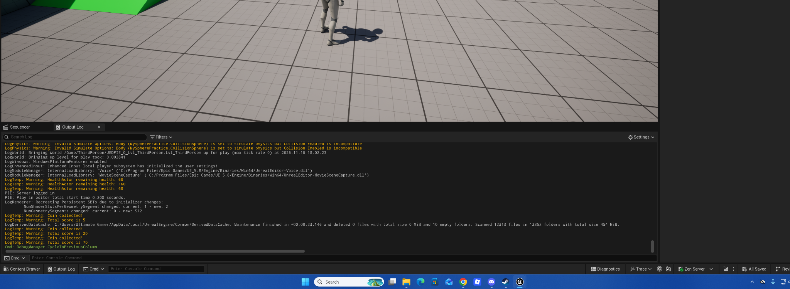

# Coin Pickup and Scoring — Unreal Engine C++

A small Unreal Engine 5 C++ learning exercise demonstrating how collectible Actors can communicate with a player character to update a shared score.

## What it does

- Creates a sphere collision component for each coin pickup.
- Detects when the player enters the sphere using an overlap event.
- Uses `Cast<ACppGameplayPracticeCharacter>` to confirm the overlapping Actor is the player.
- Adds the coin's configurable `CoinValue` to the player's `TotalScore`.
- Prints the updated total to Unreal's Output Log.
- Destroys the collected coin Actor.

## Files

| File | Purpose |
| --- | --- |
| `ACoinPickupPractice.h` | Declares the pickup Actor, its collision component, editable values, and overlap callback. |
| `ACoinPickupPractice.cpp` | Creates the collision sphere, binds the overlap event, awards points, and destroys collected pickups. |
| `Screenshots/Score-Output.png` | Output Log from a successful test. |

## Required player-character change

The existing project character, `ACppGameplayPracticeCharacter`, needs a **public** score variable in `CppGameplayPracticeCharacter.h`:

```cpp
public:
    UPROPERTY(EditAnywhere, BlueprintReadWrite, Category = "Score")
    int32 TotalScore = 0;
```

This exercise does not include the full character source because only this member was added. The `public:` access specifier matters: the pickup accesses the score through a pointer to the player character.

## How it works

1. The constructor creates a `USphereComponent`, makes it the root, applies the `Trigger` collision profile, and binds `SphereOverlap` to `OnComponentBeginOverlap`.
2. `BeginPlay()` applies the editable `DetectionRadius` to the collision sphere.
3. On overlap, `OtherActor` is cast to `ACppGameplayPracticeCharacter`.
4. If the cast succeeds, `Player->TotalScore += CoinValue` updates the player's running total.
5. The new total is logged and the coin destroys itself.

## Test result

Three placed pickup instances were assigned values of **5**, **15**, and **50**. Collecting them produced:

| Pickup | Running total |
| --- | ---: |
| +5 | 5 |
| +15 | 20 |
| +50 | 70 |



## Concepts practiced

- Unreal C++ `AActor` classes and components
- `UPROPERTY` and editable instance values
- Dynamic overlap delegates and `UFUNCTION`
- Casting an `AActor*` to a player-character pointer
- Accessing members with `->`
- Updating shared state with `+=`
- Logging with `UE_LOG`
- Destroying an Actor after collection
- C++ access control (`public` vs. `private`)

## Notes

This folder contains source files from a larger Unreal Engine project; it is **not a standalone buildable project**. The pickup class expects the project's `CppGameplayPracticeCharacter.h` and its `TotalScore` member. The score lives on the current character instance, so it is not designed to persist across character recreation, level changes, or game restarts.

The pickup currently enables Tick but does not use it for gameplay logic. That could be disabled as a future cleanup; it was left unchanged for this exercise.
